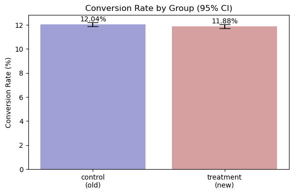

# A/B 테스트 — 새 랜딩 페이지는 전환율을 높이는가?

> Kaggle 랜딩 페이지 A/B 테스트 데이터(29만 명)로 새 페이지의 효과를 검정하고, **출시 / 보류 / 추가 수집** 중 하나를 근거와 함께 제안한 개인 과제 (D017)

| | 한눈에 보기 |
|---|---|
| **문제** | 새 랜딩 페이지(`new_page`)로 바꾸면 기존 페이지보다 전환율이 오를까? |
| **결과** | 전환율 새 페이지 **11.88%** vs 기존 **12.04%** — 차이 −0.16%p, 95% 신뢰구간 [−0.39, +0.08]%p로 0을 포함 (χ²(1)=1.72, p=0.19, Cramér's V=0.002) |
| **판단** | **출시 보류.** 유의하지 않고, 방향도 음수이며, 효과크기도 0에 가깝다. 표본으로 잡을 수 있는 최소 효과(MDE)가 0.34%p라서 "표본이 부족해서 못 찾았다"고 보기도 어렵다 |

## 분석 흐름

### 1. 데이터 위생 점검 — 검정보다 먼저

데이터가 오염돼 있으면 p값은 의미가 없어서, 검정 전에 네 가지를 확인했습니다.

| 점검 | 확인한 것 | 결과 |
|---|---|---|
| 기본 | 행 수·컬럼·자료형·결측치 | 294,478행, 결측치 0 |
| 배정 일관성 | `control`→`old_page`, `treatment`→`new_page`가 맞는지 | 어긋난 행 3,893개 → 어떤 처치를 받았는지 믿을 수 없어 제거 |
| 중복 | 같은 `user_id`가 두 번 이상인지 | 처음엔 중복 3,894행. 어긋난 행을 지우고 나니 남은 중복은 1행 → 제거 (한 사용자 = 한 번) |
| SRM | 배정 비율이 50:50인지 | control 147,202 vs treatment 147,276, p=0.89 → 배정 정상 |

정제 결과 **294,478행 → 290,584행**.

### 2. 질문과 가설

- H₀: 두 페이지의 전환율은 같다 / H₁: 다르다
- α = 0.05, **양측검정** — 새 페이지가 오히려 더 나쁠 가능성도 열어 두기 위해서

### 3. 검정 고르기

- 성공 지표가 전환 여부(0/1)라 **비율**이고, 비교 집단이 **2개** → **카이제곱 독립성 검정**
- 평균을 비교하는 t검정·ANOVA는 매출·체류시간 같은 연속형 지표용이라 맞지 않음

### 4. 결과 — p값 하나가 아니라 3종 세트로

| | 값 |
|---|---|
| 점추정 | −0.158%p (상대 −1.31%) |
| 95% 신뢰구간 | [−0.394%p, +0.078%p] → 0 포함 |
| 효과크기 | Cramér's V = 0.002 (사실상 0) |
| 검정 | χ²(1) = 1.72, p = 0.190 → 귀무가설 기각 못 함 |

### 5. 한 걸음 더 — "효과가 없다"인가, "확인할 힘이 없었다"인가?

- 그룹당 약 14.5만 명 표본으로 검출할 수 있는 **최소 효과(MDE)는 약 0.34%p**
- 관측된 차이(−0.16%p)는 이보다 작고 방향도 음수 → 표본을 더 모아도 의미 있는 개선이 나올 가능성은 낮음
- 사후 검정력은 계산하지 않았습니다. 관측 p값을 다르게 쓴 것에 불과하기 때문입니다.

### 6. 의사결정과 한계

**결정: 출시 보류.** 새 페이지는 전환율을 높인다는 근거가 없고, 표본 크기도 충분했다.

한계
- 데이터에 "전환"이 정확히 무엇인지(구매, 가입 등) 정의가 없다.
- 실험 기간이 짧아 새로움 효과나 요일 효과를 다 담지 못했을 수 있다.
- 기기·유입 경로·요일 같은 세그먼트별로는 결과가 다를 수 있는데 전체만 봤다.

## 파일

| 파일 | 설명 |
|---|---|
| `ab_test_full.ipynb` | 전체 분석 노트북 (위생 점검 → 가설 → 검정 → 3종 세트 → MDE → 의사결정). 난수 고정으로 다시 실행해도 같은 결과 |
| `images/conversion_rate_ci.png` | 그룹별 전환율과 95% 신뢰구간 |

## 데이터

Kaggle [Landing Page A/B Testing](https://www.kaggle.com/datasets/zhangluyuan/ab-testing) (`ab_data.csv`, 2026-08-09 내려받음). 데이터 파일은 저장소에 포함하지 않았습니다.

## 사용 기술

Python, pandas, NumPy, SciPy (카이제곱 검정), statsmodels (비율 검정·검정력/MDE), matplotlib
