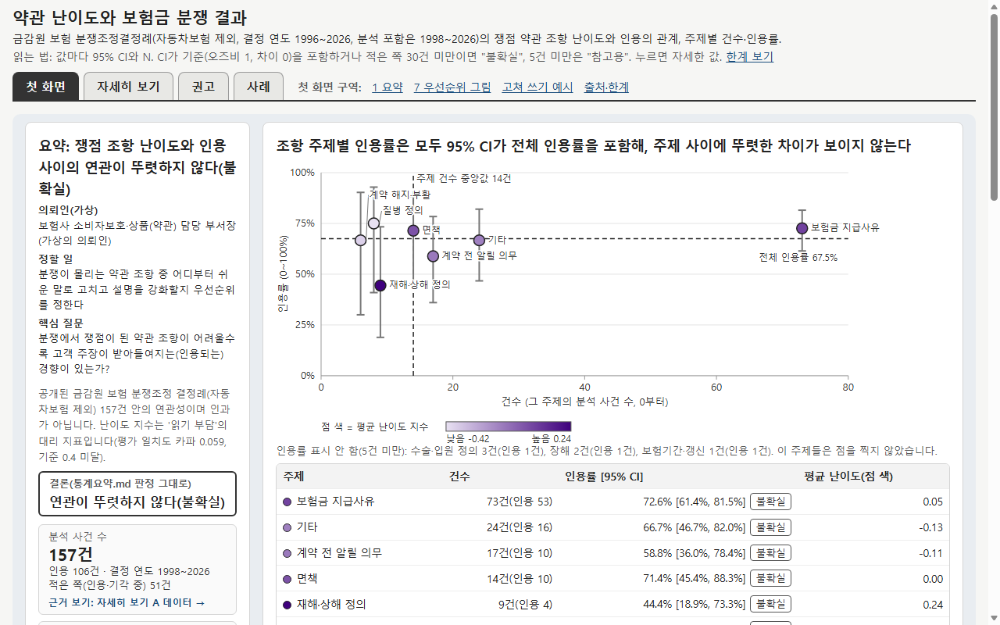

# 약관 난이도와 보험금 분쟁 결과 (보험 CX)

> 금융감독원 보험 분쟁조정 결정례를 수집·라벨링해 "쟁점이 된 약관 조항이 어려울수록 고객 주장이 받아들여지는가"를 분석하고, 보험사 약관 담당 부서가 어떤 조항부터 쉽게 고칠지 정하도록 웹 대시보드로 정리한 3인 팀 프로젝트 (CX 분석 과제)

## 배경·문제정의

- **질문**: 분쟁에서 쟁점이 된 약관 조항이 어려울수록 고객 주장이 받아들여지는(인용되는) 경향이 있는가? 인과가 아니라 **연관성**만 봅니다.
- **가상의 의뢰인**: 보험사 소비자보호·상품(약관) 담당 부서장. 결정할 것: "분쟁이 몰리는 약관 조항 중 어디부터 쉬운 말로 고치고 설명을 강화할지" 우선순위.
- **보조 결과**: 연도별 인용률·쟁점 유형 추이, 분쟁이 자주 생기는 약관 조항 주제 상위 10개.
- 분석 규칙(시기 구간, 표본 기준, 민감도 분석, 판정 문장 등)은 데이터를 보기 전에 `PROJECT.md`에 고정하고, 바꾼 내용은 변경 기록에 남겼습니다.

## 데이터

- 금융감독원 금융분쟁조정위원회 보험 분쟁조정 결정례(공개 게시물 445건, 자동차보험 제외, 분석 포함 1998~2026년) — `fss_collect.py`로 허용 범위에서 수집(요청 간격 3초 이상)
- 생명보험·질병상해보험·실손의료보험 표준약관(난이도 기준 분포)
- **결정문 원문, 변환 텍스트, 라벨 데이터(csv·xlsx)는 이 저장소에 포함하지 않았습니다.** 출처 정책상 원문은 올리지 않습니다(`docs/수집근거표.md`).

## 분석 방법

1. **수집·변환**: 결정례 목록·상세 수집, hwp 첨부를 텍스트로 일괄 변환(`hwp_batch.py`)
2. **파일럿(27건)**: 시기별 변환 성공률, 조항 추출 위치(위원회 판단 vs 당사자 주장) 판정, 라벨 규칙 확정
3. **라벨링**: 인용 여부, 쟁점 유형, 설명의무, 모호성 판단을 규칙 기반으로 붙이고, 골드 표본 30건을 사람이 원문과 대조
4. **규칙 vs LLM vs 사람 비교(relabel)**: 규칙 라벨, LLM 전체 읽기, LLM 조각 판정을 골드셋·빈틈 챌린지셋과 비교
5. **난이도 지수**: 문장 길이, 전문용어, 예외·단서 표현 등 지표를 표준화해 종합 지수로 만들고, 두 평가자의 가린 평가로 타당성 확인
6. **통계**: 로지스틱 회귀 주 모형(난이도 + 쟁점 유형 + 시기, 필요 시 Firth 보정), 예측 인용 확률, 층화(Mantel-Haenszel), 필수 민감도 4개, 시계열
7. **탐색적 보조 분석**: 표준약관 대비 조항 난이도 프로필, BERTopic 토픽 분석
8. **대시보드**: 의뢰인 기준 첫 화면, 권고(고쳐 쓰기 예시), 사례 탭, 자세히 보기
9. 단계마다 Claude Code 에이전트(`agents/`)가 실행하고, 별도 검수 에이전트와 사람이 숫자를 다시 확인

## 핵심 결과

- 분석 157건(인용·일부 인용 106, 기각 51), 전체 인용률 0.675 [0.599, 0.744]
- **주 모형**: 난이도 1 SD당 오즈비 **0.770** [0.524, 1.130], p = 0.182 → 결과 문장 **"연관이 뚜렷하지 않다(불확실)"**
- 예측 인용 확률 차이(난이도 상위 25% − 하위 25%): -0.054 [-0.153, 0.019]
- 필수 민감도 4개(일부 인용 처리, 조항 추출 위치, 조 전체 통일, 2010년 이후만) 모두 같은 방향
- 라벨 대조(골드 30건): `cited` 30/30, `ambiguity`는 규칙 25/30, LLM 전체 읽기 27/30
- 두 평가자의 난이도 평가 일치도(가중 카파) 0.059 → 0.4 미만이라 한계로 명시. 난이도 지수는 "읽기 부담"의 대리 지표로만 해석
- 범위: 공개된 금감원 보험 분쟁조정 결정례(자동차보험 제외) 안의 연관성이며 인과가 아닙니다.

## 내 역할 (유빈) — 데이터·라벨링 담당

- 프로젝트 규칙 문서(`PROJECT.md`) 작성과 변경 기록 관리, 저장소·`.gitignore` 정리
- 결정례 수집·변환 스크립트(`fss_collect.py`, `hwp_batch.py`) 실행과 수집근거표 작성
- intake·case-parser 에이전트로 파일럿과 전체 라벨링 → 분석용 사건 표 완성
- 규칙 vs LLM vs 사람 라벨 비교 실험(`relabel/`)
- 난이도 평가자, 통계 결과 재실행 대조(검수)

## 폴더 안 파일

| 파일·폴더 | 설명 |
|---|---|
| `PROJECT.md` | 프로젝트 공통 규칙, 고정 기준값, 열 정의, 변경 기록 (팀원 이름은 팀원B·팀원C로 가림) |
| `00_총정리_안내.md` | 전체 폴더 지도와 정리 순서 |
| `fss_collect.py`, `hwp_batch.py` | 결정례 수집, hwp → 텍스트 변환 |
| `requirements.txt` | 실행 환경(Python 3.10) |
| `agents/` | 단계별 분석 에이전트 설정(수집, 라벨링, 난이도, 통계, 검수, 보고서, 대시보드) |
| `docs/` | 분석 계획서 v7, 코드북, 수집근거표, 제외 사유, 검수 체크리스트, 단계별 지시(`지시/`)·보고(`보고/`)·제안(`제안/`), 계산 기록 스크립트 |
| `relabel/` | 라벨 비교 실험 코드와 결과(`결과.md`), 격리 LLM 실험 설정 |
| `outputs/stats/` | 통계·난이도 프로필·토픽 분석 코드(`analysis.py`, `difficulty_profile.py`, `topic.py` 등), 결과 요약 md, 그림(`figs/`) |
| `outputs/qual/` | 정성 확인, 분쟁조정 사례 정리 |
| `report/` | 발표 뼈대, 보고서 초안 |
| `dashboard/` | 웹 대시보드(`index.html` + 결과값 js 4개), 데이터 출처, 화면 캡처(`screenshots/`) |

## 사용 기술

Python, pandas, NumPy, SciPy, statsmodels, scikit-learn, firthlogist, kiwipiepy(형태소 분석), BERTopic·sentence-transformers, matplotlib, requests·BeautifulSoup(수집), HTML/CSS/JavaScript(대시보드), Claude Code 에이전트(라벨링·검수 워크플로)

