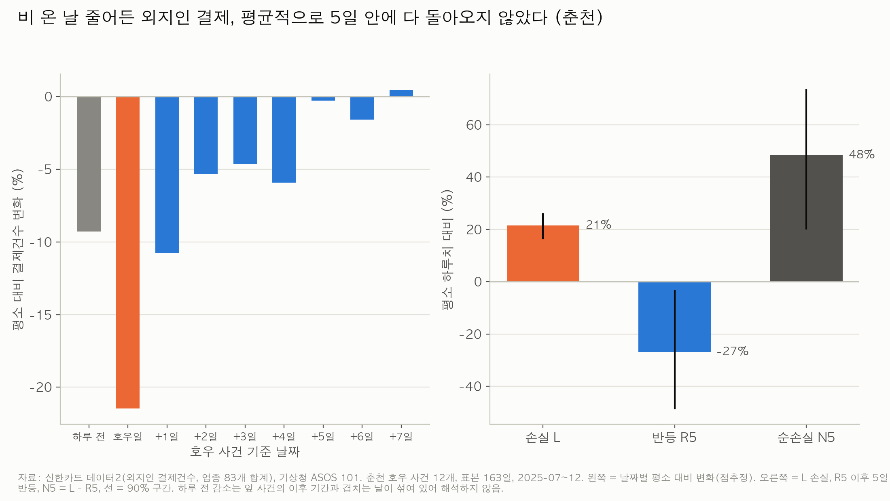
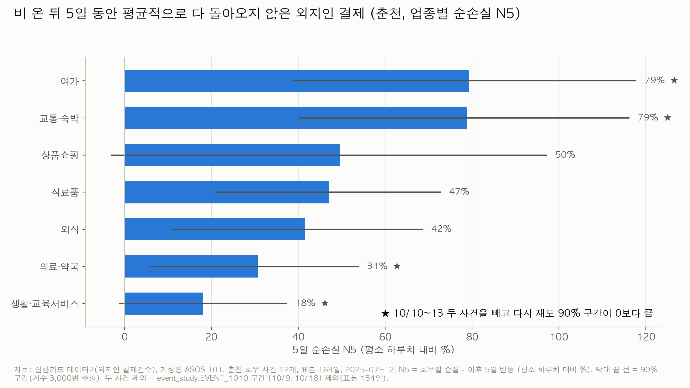

# 비 한 번에 놓치는 외지인 매출 (기후·상권 분석)

> 신한카드 결제 데이터와 기상청 강수 자료로 "큰비가 온 날 관광형 상권의 외지인 매출이 얼마나 줄고, 며칠 안에 돌아오는가"를 이벤트 스터디로 측정하고, 취약 업종의 지원 우선순위와 30mm 날씨지수 보험을 제안한 3인 팀 프로젝트 (2026 빅콘테스트 AI데이터 분석 분야)

| | 한눈에 보기 |
|---|---|
| **문제** | 기후 위기로 잦아진 호우에 상권은 얼마나 피해를 입고, 그 피해는 며칠 뒤 회복되나? 어느 지역·업종부터 어떻게 지원해야 하나? |
| **결과** | 30mm 이상 호우일에 춘천 외지인 결제건수 **−21.5%** [90% 구간 16.5, 25.9], 12개 사건 모두 감소. 5일 뒤에도 평소 하루치의 **48.3%** [20.2, 73.3]를 되찾지 못함(사건별로는 12개 중 9개). 금액으로 비 한 번에 약 **7.0억 원** [2.9억, 10.6억] (신한카드 외지인분만 센 최소 추정). 업무형 강남은 뚜렷한 영향이 확인되지 않음 |
| **제안** | 지원 우선순위 14칸 중 1위 **춘천 여가(96점)** 부터 시범 도입. ASOS 일강수량 30mm 이상이면 피해 조사 없이 정액을 주는 **30mm 날씨지수 보험** (발동 빈도 30년 평균 연 9.93회, 춘천 여가 점포당 비 한 번에 2.4만~19.0만 원) + 비 예보 단계의 급감 알림. 강남은 보험 대상에서 빼고 관찰 |
| **내 역할** | 분석·모델링 주로 담당, 전처리와 발표 자료는 팀 공동 (3인 팀) |
| **대회 결과** | 본선 미진출 |

**📄 [제출한 결과보고서 보기 (PDF, 26쪽)](bigcontest_final_report.pdf)** — 팀원 이름만 가렸습니다.

## 배경·문제정의

- 대회 주제는 "기후 위기에 따른 취약 상권 영향 분석"입니다. 기존 재해 통계와 지원 제도는 침수·파손 같은 **재산 피해**만 집계하고, 손님이 오지 않아 **놓친 매출**은 거의 다루지 않습니다.
- 그래서 세 가지를 물었습니다.
  1. 비 오는 날 **누가 얼마나** 덜 쓰나? (민감도)
  2. 못 쓴 돈은 며칠 뒤 **돌아오나, 사라지나**? (적응력)
  3. 그렇다면 **어디부터, 얼마를, 언제** 지원하나? (우선순위·보험 설계)
- 분석 단위는 지역(관광형 춘천, 업무형 강남) × 업종 7그룹 × 하루, 기간은 2025-07-01 ~ 12-31(184일)입니다.

## 데이터

| 구분 | 데이터 | 용도 |
|---|---|---|
| 대회 제공 | 신한카드 결제 데이터1·2 (춘천·강남, 2025-07~12) | 외지인 결제건수·금액(데이터2), 폭염 시간대·연령 탐색(데이터1) |
| 대회 제공 | SK 통신 유동인구 (월별 하루 평균, 18개 파일) | 지역 구조 비교(주말/평일, 60대 이상 비중) |
| 공공 | 기상청 ASOS 7개 지점(2025), ASOS 30년 일강수량(1995~2025), 강남 AWS 400, 기상특보 | 호우 사건 정의, 보험 발동 빈도, 관측소 민감도 |
| 공공 | 한국관광공사 지역별 방문자 수 | 다른 자료로 교차 확인, 5개 지역 유형별 추정 |
| 공공 | 소상공인시장진흥공단 상가(상권)정보 2025 | 업종 그룹별 점포 수, 점포당 손실 |
| 공공 | 소상공인실태조사 2023, 행정안전부 풍수해보험 자료 | 영업이익률 12.6%, 정부 지원율 55% (보험 설계 가정) |

- **대회 제공 데이터(신한카드·SK)와 그 레이아웃 파일, 이를 가공한 행 단위 데이터는 대회 규정상 이 저장소에 포함하지 않았습니다.** 외부 데이터 원본(csv·xlsx)도 올리지 않았고, 출처와 가공 방법은 `docs/data_additions.md`에 있습니다.
- 그래서 코드는 이 폴더만으로는 실행되지 않습니다. 노트북에는 집계된 모형 결과(회귀 계수·오차·점수표)만 출력으로 남아 있고, 원본 행은 없습니다.

## 분석 방법

- **전처리**: 날씨와 무관한 7개 업종 제외 → 83개 업종을 7그룹으로 묶음(결과를 보기 전에 업종 성격으로만 정함) → 거주 시도로 외지인 구분(춘천 가맹점 = 강원 밖 거주자, 강남 = 서울 밖) → 하루 단위 집계
- **호우 사건**: 일강수량 30mm 이상인 날이 이어지면 1회. 연휴와 겹친 사건은 제외 → 춘천 12개, 강남 10개
- **이벤트 스터디(OLS)**: `ln(외지인 결제건수) ~ 호우일 + 전날 + 이후 1~7일 + 약한 비 + 폭염 + 요일 + 공휴일·연휴 + 월`, HAC 표준오차, 90% 구간은 3,000번 추출(시드 2026)
  - L = 호우일 하루 손실, R5 = 이후 5일 반등, **N5 = L − R5 (5일 뒤에도 못 되찾은 순손실)**
- **검증**: 사건별 반복, 사건 하나씩 빼기, placebo 1,000회, lead test, 관측소 교체(서울 108 → 강남 AWS 400), 관광공사 방문자로 교차 확인, 4개 실행 환경 재현, 팀 코드 없이 독립 재계산
- **손실 예측 모델**: 달력만 쓴 기준 모델 vs 회귀+날씨 vs 트리(GBM)+날씨, 사건 하나씩 빼고 검증(leave-one-event-out) MAE 비교
- **지원 우선순위**: 14칸(2지역 × 7업종)마다 점포당 기대 손실(40)·N5(20)·외지인 의존도(20)·확실성(20)을 순위 백분위로 바꿔 0~100점, 민감도 시나리오 9개
- **날씨지수 보험 설계**: 30년 강수로 발동 빈도 계산, 점포당 사건당 지급액을 "매출 손실 × 12.6%(가게 손해) ~ × 100%(매출 전체)" 범위로 제시, 기준 위험(basis risk) 점검

## 핵심 결과

| 분석 | 핵심 숫자 | 확신 정도 |
|---|---|---|
| 호우일 손실 | 춘천 외지인 L **21.5%** [16.5, 25.9], 12/12 사건 감소 | 강함 |
| 5일 순손실 | 춘천 외지인 N5 **48.3%** [20.2, 73.3], 사건별 양수 9/12 (p=0.146) | 보통 |
| 업종별 | 여가 79.2%, 교통·숙박 78.7%가 가장 큼. 10월 두 사건을 빼도 유의한 그룹은 4개(여가·교통·숙박·의료·약국·생활·교육서비스) | 보통 |
| 강남 | 외지인 N5 3.5% [−5.6, 12.7], AWS 400 기준 0.6% → 뚜렷한 영향 확인 안 됨 | 보통 |
| 금액 | 춘천 외지인 비 한 번에 약 7.0억 원 [2.9억, 10.6억] (택시 제외, 최소 추정) | 보통 |
| 예측 모델 | 춘천 외지인 MAE 0.097 → 0.071 (**−27%**, 트리+날씨, 11/12 사건 개선). 강남은 개선 없음 | 보통 |
| 지원 우선순위 | 1위 춘천 여가 96점, 상위 4칸이 민감도 9개 중 7개 시나리오에서 유지 | 보통 |
| 보험 | 발동 연 9.93회(춘천, 30년), 춘천 여가 점포당 사건당 2.4만~19.0만 원 | 추정 |
| 기준 위험 | 정액(평균 15.1%)으로 주면 12개 사건 중 7개가 실제 손실과 크게 어긋남 | 보통 |
| 교차 확인 | 관광공사 방문자로도 춘천 외지인 L 14.4% [6.8, 21.2], 같은 방향 | 보통 |
| 폭염(탐색) | 60대 이상 결제가 낮(12~17시) −2.2% → 저녁(18~23시) +3.7%로 이동 (춘천) | 약함 |

**해석할 때 주의할 점 (보고서에 적은 한계)**
- 신한카드 결제만, 2025년 하반기 6개월, 춘천 사건 12개·강남 10개로 사건 수가 적습니다. 10월 두 사건을 빼면 합계 N5 구간이 0을 포함합니다.
- 2025년 하반기는 30년 중 호우가 가장 잦은 시즌(춘천 14회)이라 평범한 해로 일반화하지 않습니다.
- 금액은 외지인 신한카드분만이라 실제보다 작은 최소 추정입니다. 보험금은 모든 점포가 같은 피해를 입고, 1~6월 비도 같은 피해를 준다고 가정했습니다. 영업이익률 12.6%·정부 지원율 55%는 외부 수치를 빌린 가정입니다.
- 서울 관측소 108은 종로구에 있어, 강남은 AWS 400으로 따로 확인했습니다. 강남 업종별 결과는 관측소에 따라 달라집니다.
- 우선순위의 "금액 구간이 0을 포함하면 0" 규칙은 결과를 본 뒤 추가한 규칙이라 보고서에 그대로 밝혔습니다.

## 돌아보며

- **잘된 점**: 기준(30mm, 업종 그룹, 가중치)을 결과를 보기 전에 정하고, 사건별 반복·placebo·관측소 교체·다른 자료(관광공사)·환경별 재현까지 검증 장치를 여러 겹 둔 덕분에 "줄어든다(12/12)"와 "사라진다(9/12)"를 확신 정도에 맞춰 나눠 말할 수 있었습니다.
- **예측 모델의 한계에서 배운 점**: 모델은 "비 오면 줄어든다"는 맞혔지만, 어느 비가 더 큰 피해를 줄지는 맞히지 못했습니다(사건별 손실과 상관 0.01~0.16). 사건 수가 12개뿐인 문제에서는 모델 성능보다 이 한계를 보험의 기준 위험 근거로 연결한 것이 더 쓸모 있었고, 다음에는 더 긴 기간·더 많은 지역의 사건을 확보하는 것부터 계획하겠습니다.
- **데이터 단위 확인을 먼저**: SK 유동인구는 일별이 아니라 한 달 평균 자료여서 "비 온 날" 분석에는 쓸 수 없었고 지역 구조 비교로만 활용했습니다. 제공 데이터의 시간 단위와 정의를 주제 설계 전에 확인해야 한다는 점을 배웠습니다.
- **좁은 표본의 일반화**: 카드 데이터가 있는 지역이 춘천·강남 두 곳뿐이라 나머지 지역은 방문자 자료로 "추정"까지만 했습니다. 결론의 범위를 데이터가 받쳐 주는 만큼으로 제한해 쓰는 연습이 됐습니다.

## 폴더 안 파일

| 파일·폴더 | 설명 |
|---|---|
| `bigcontest_final_report.pdf` | 대회에 제출한 최종 결과보고서 (26쪽, 팀원 이름 가림·용량 축소판) |
| `src/prep.py` | 전처리(P1~P10): 업종 제외·그룹, 외지인 구분, 호우 사건, 달력, SK 중복 제거 |
| `src/run_check.py` | 전처리 검산 숫자 50개 확인 |
| `src/event_study.py` | 호우 이벤트 스터디(L·R5·N5), placebo·사건 빼기, 기존 보고값 93개 대조 |
| `src/rain_followup.py` | 금액 환산, 사건별 반복성, 50mm 대 30mm 비교 |
| `src/model.py` | 손실 예측 모델 3종, leave-one-event-out 평가 |
| `src/priority.py` | 업종 연결표, 점포 수, 지원 우선순위 점수와 민감도 |
| `src/insurance.py`, `src/rain_freq.py` | 날씨지수 보험 설계 계산, 30년 호우 발동 빈도 |
| `src/heat.py` | 폭염 분석(카드 데이터1, 시간대·연령·업종별) |
| `src/aws_check.py`, `src/visitor_check.py`, `src/regions.py`, `src/sk_structure.py` | 관측소 민감도, 관광공사 방문자 교차 확인, 5개 지역 추정, SK 지역 구조 비교 |
| `src/rain_2026.py` | 2026년 호우 참고 비교 |
| `src/figures.py` | 발표용 그림 7개 생성 |
| `notebooks/04_모델링.ipynb` | 손실 예측 모델 결과와 해설 |
| `notebooks/05_폭염.ipynb` | 폭염 분석 결과와 해설 |
| `notebooks/06_우선순위.ipynb` | 지원 우선순위 점수·민감도 결과와 해설 |
| `outputs/fig1~fig7_*.png` | 발표용 그림(30년 호우 빈도, 기준 위험, 점포당 보험금, 업종별 N5, 사건 전후, 강남 관측소 비교, 우선순위 점수) |
| `docs/분석요약.md` | 모든 핵심 숫자의 90% 구간·확신 정도·한계 한 장 요약 |
| `docs/전처리_명세서.md` | 전처리 규칙과 검산 기준값 |
| `docs/data_additions.md` | 덧붙인 변수·업종 연결표·점수 정의, 외부 데이터 출처 (대회 제출 자료) |
| `docs/aws_sensitivity.md` | 강남 관측소(108 대 AWS 400) 민감도 결과 |
| `LLM_USAGE.md` | LLM(Claude) 사용 기록 (대회 제출 필수 자료, 팀원 이름은 팀원A·B로 가림) |
| `requirements.txt` | 최종 실행 환경 패키지 버전 |

## 사용 기술

Python, pandas, NumPy, statsmodels(OLS·HAC), scikit-learn(GradientBoosting), matplotlib, Jupyter, 이벤트 스터디, 부트스트랩·placebo 검정
