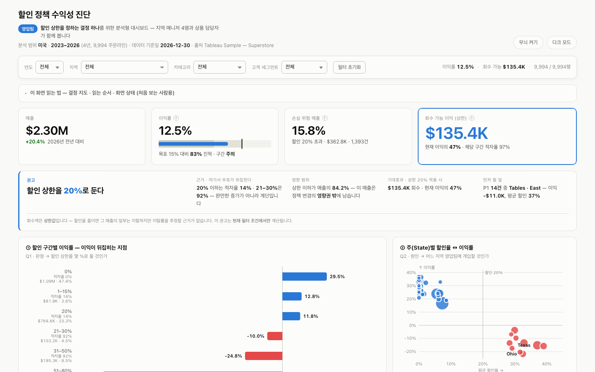

# 할인 정책 수익성 진단 대시보드 (개인 과제)

> Tableau 샘플 데이터(Superstore)로 "할인을 어디까지 줘도 이익이 남는가"를 찾고, 영업팀이 할인 상한을 정하도록 돕는 분석형 대시보드

| | 한눈에 보기 |
|---|---|
| **문제** | 할인이 매출을 늘리지만, 어느 수준부터 이익을 깎아 먹는가? |
| **결과** | 할인 20% 이하 구간은 흑자, 21~30%부터 이익률이 적자로 뒤집힘. 할인 20% 초과 매출이 전체의 15.8% |
| **제안** | **할인 상한을 20%로** 두면 회수 가능 이익(상한) $135.4K, 현재 이익의 47% |

**▶ [대시보드 바로 보기](https://yub-2n.github.io/ai-data-bootcamp/%EB%8C%80%EC%8B%9C%EB%B3%B4%EB%93%9C/superstore_discount_dashboard.html)**

## 파일

| 파일 | 설명 |
|---|---|
| `superstore_eda.ipynb` | 탐색적 분석(EDA) |
| `기획안_스케치.md` | 대시보드 기획: 사용자·지표·위계·차트를 그리기 전에 결정한 기록 |
| `superstore_discount_dashboard.html` | 최종 대시보드 (필터, 다크 모드, 읽는 법 안내 포함) |

사용 기술: pandas, HTML/CSS/JavaScript (차트 직접 구현)
